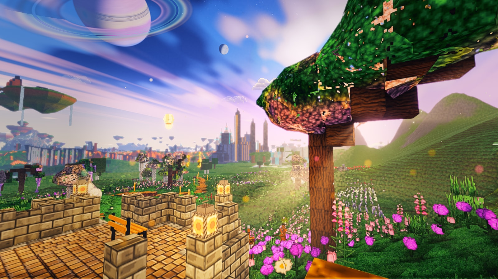
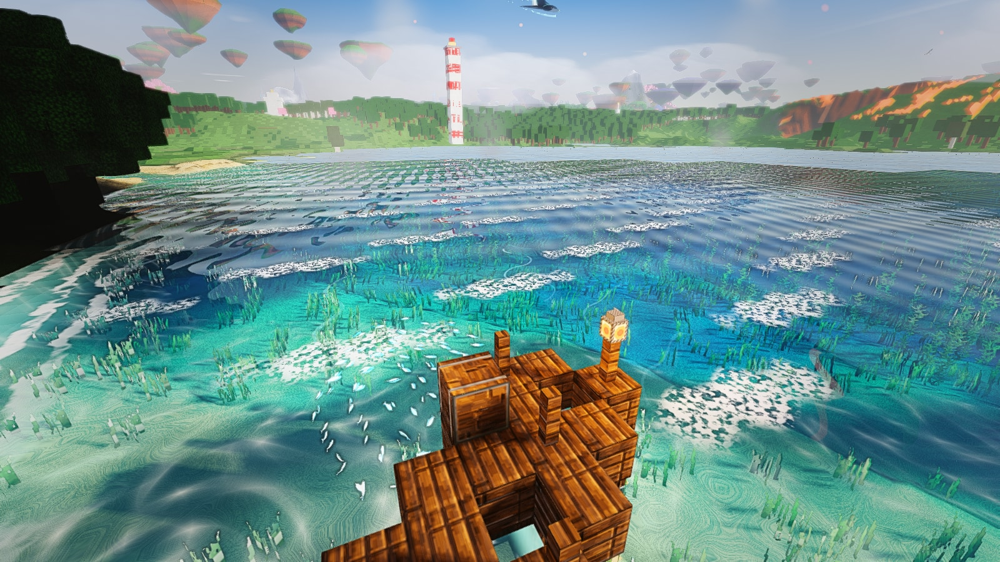
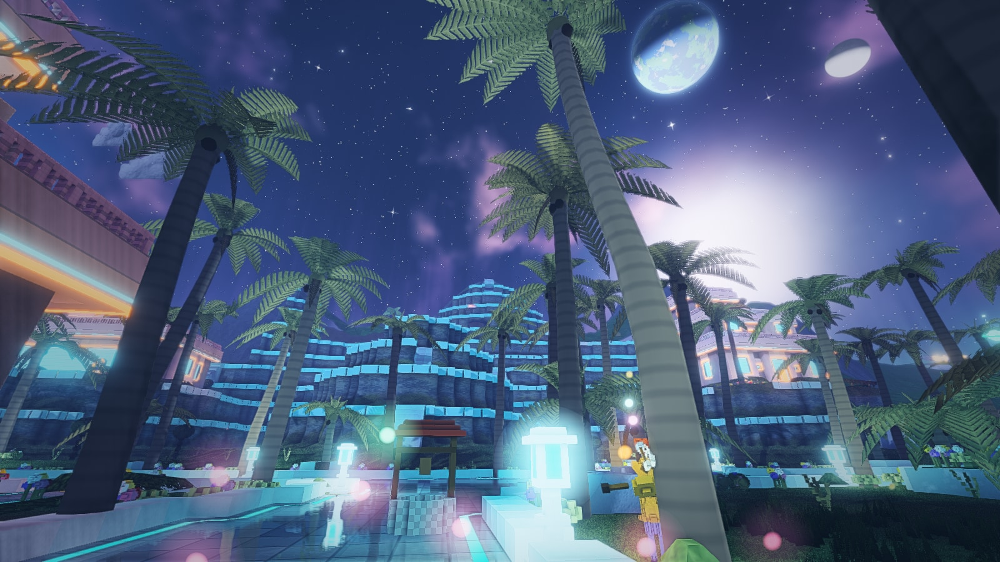

# R9-SI

A browser voxel world (WebGL 2, web workers, no engine, no install) with its editor R9 Studio. Everything in it is
procedural and our own: the terrain, the cities, the textures, the sky, the water, the sounds, the people.

## Gallery · Bilder

Every picture below is the game itself on its Ultra preset, rendered headless in software (SwiftShader) by
[`test/marketing_shots.mjs`](test/marketing_shots.mjs) — no paint-over, no other engine. *Jedes Bild ist das Spiel selbst.*

<table>
<tr><td></td><td></td></tr>
<tr><td></td><td></td></tr>
<tr><td colspan="2"></td></tr>
</table>

## The mathematics as a book · Die Mathematik als Heft

**[R9-SI — Die Mathematik und Physik einer Voxelwelt im Browser (PDF)](docs/R9-SI_Mathematik_und_Physik.pdf)** — 16
chapters, 178 formulas, each one as the game computes it, with the file it lives in: simplex noise and the terrain's
climate fields, light and ambient occlusion, surface nets, collision, Gerstner-like water with Lengyel's oblique mirror,
wind, Rayleigh/Mie skies after Hillaire, GGX materials, ACES, the R9 Super Resolution, Kepler orbits with universal
variables, the upload budget and the synthesized music. The source of the book is
[`docs/math/r9si_mathematik.html`](docs/math/r9si_mathematik.html) (`node docs/math/build_pdf.mjs`).

## Play

**Download → double-click → play.** [`play/R9-SI.html`](play/R9-SI.html) is the whole game in one file; the editor is
[`play/R9-SI-Studio.html`](play/R9-SI-Studio.html). On GitHub open the file and press *Download raw file*, or take the
repository as a ZIP (*Code → Download ZIP*) and open `play/R9-SI.html`. Chrome, Edge or Firefox; worlds are saved in
your browser. Build it yourself with `node build.js` → `dist/` (plain JavaScript, nothing to install).

**An independent work.** R9-SI and R9 Studio are an independent, non-commercial hobby project — an original voxel game
inspired by the block sandbox genre. They are not affiliated with, endorsed, sponsored or approved by any other game
company. NOT AN OFFICIAL MINECRAFT PRODUCT. NOT APPROVED BY OR ASSOCIATED WITH MOJANG OR MICROSOFT. Minecraft is a
trademark of Mojang. Impressum, privacy policy and credits: 📜 in the pause menu, the settings and the Studio's header.

**Files.** The Studio opens structures from WorldEdit / Amulet / Axiom (.schem), vanilla structure files (.nbt),
Litematica (.litematic), MagicaVoxel (.vox) and R9 Bauteile (.json), and exports .schem, .vox and .json.
NOT AN OFFICIAL MINECRAFT PRODUCT. NOT APPROVED BY OR ASSOCIATED WITH MOJANG OR MICROSOFT. WorldEdit, Amulet,
Axiom, Litematica, MCEdit and MagicaVoxel are names or trademarks of their respective owners, named only to describe
which files the Studio reads and writes. Share only what is yours — every export says so in one line.

The long release notes live in [docs/CHANGELOG.md](docs/CHANGELOG.md); how to work on the code in [AGENTS.md](AGENTS.md).

## The mathematics and physics inside

**The world.** Seeded simplex noise (2D/3D) with fractal sums shapes the land; the climate (temperature, humidity,
height) picks the biome and the plants. Generation is versioned (`vgen`): a world made at any version regenerates
byte-identical for ever, which `test/gen_same.js` pins with reference hashes. Block ids are append-only, so every saved
world stays readable.

**Light.** Sky light falls straight down, 15 at the top and −1 per blocked step; block light is an RGB flood fill (three
channels at once, −1 per step, filtered through coloured glass). Each vertex carries its light word and an ambient
occlusion term from its three neighbouring voxels; the mesher packs a vertex into 8 × 16 bits (position, texture layer,
rotation, UV, face, AO, sway, light, tint).

**The sky.** A procedural sky model with the sun, a ringed gas giant with its moons and a blue planet moving on their own
orbits (angular radii in radians, the giant circling at ~33°, its ring never face-on); the day's colour runs through
three measured stops — white-cyan at the horizon, blue, navy space with stars and the nebula at the zenith; lavender,
violet, navy at dusk. The targets were measured from the trailer frames and the game lands within ΔE 7–11 per band.
The fog takes the horizon's colour, so the far world never seams against the sky.

**Water.** The surface is a sum of three Gerstner-like octaves with a crest-sharpening normal term, the same table on the
CPU (the bob of a swimming player) and in the shader. The reflection is a planar mirror about the water plane with
Lengyel's oblique near plane clipping whatever lies under the surface; refraction reads the scene colour and depth.

**Weather and wind.** The weather schedule (clear, cloudy, fog, rain, storm, snow) is a pure function of the world seed,
the day and the climate, so a host and every guest agree without a single message. There is one wind for the whole
world: a function of world time whose terms repeat in thirds of a day, so midnight has no jump; the plants, the water,
the clouds and the sound all read it.

**Rendering.** Section meshes live in arena buffers and go out as multi-draws; cave and frustum culling decide what is
drawn. The far world is a quadtree of LOD tiles (4-, 8-, 16-, 32-block cells) that the workers sample straight from the
climate and density functions without generating chunks; a 64 × 64 mask of the chunks really drawn lets the shader cut
the tiles away exactly there, and a 4 × 4 Bayer dither fades a new chunk in over 300 ms with the rule "never above the
chunk's own fade", so no pixel is ever a hole. Shadows come from one cached map (3072² on Ultra) that is only redrawn
when the sun stepped 0.25°, the camera left the middle 18 % of it or blocks changed nearby; four hardware-filtered
compare taps soften it. HDR, bloom, god rays, ACES tone mapping, FXAA.

**R9 Super Resolution.** The scene is rendered below the screen's resolution with a different sub-pixel offset every
frame (a Halton 2,3 sequence over 8 frames); the resolve reprojects last frame's full-resolution result through the
depth buffer, keeps what still agrees with the new samples (colour-box clipping) and blends the new jittered samples
in, read back through a 5-tap Catmull-Rom fetch so the history never goes soft. Detail builds up over a few frames.

**Smart quality.** Two ladders instead of one blur knob. The GPU ladder: shadow map every other frame → god rays off →
shorter detail radius → smaller shadow map → simple clouds → only then a resolution step. The CPU ladder: simulation and
mesh budgets → villagers drawn closer → fewer mesh jobs. Every step is probed and undone if it buys nothing; the
decision reads the GPU's own timer queries against the main thread's time. The Automatik measures 3 s and picks a step
on a ladder of nine (preset × view distance) from the ratio of frame time to budget; the Stufentest measures every step
and names the one that is smooth (the slow frames still make 50 fps) and the one that is playable (30 fps median).

**Streaming.** Uploads to the GPU are paid in bytes from a measured price: a 1 MB calibration at world start, then a
ring of four GPU fences polled without blocking feeds a weighted fit of milliseconds per byte on this very machine; the
frame's budget shrinks after an overrun and grows with headroom, meshes go up in packets that may straddle frames while
the old mesh keeps drawing, and the queue is sorted by the view every frame — in front first, nearest first.

**Form from voxels.** Any voxel volume becomes a smooth surface by naive surface nets: one vertex per dual cell at the
mean of its sign-changing edge midpoints, one quad per sign-changing voxel edge, then two or three Laplacian passes
clamped to ±0.35 voxel so a thin leg never collapses; creases stay where the material or colour changes sharply. The
furniture, the palms, the Studio's new shapes (bodies of revolution, extrusions along a path, rounding) all pass through
it; the fine 32-cells-a-block mesh is drawn only within a quarter of the detail radius.

**People.** Villagers are a hi-res rig (1 voxel = 1/32 block) with joints that rotate about elbow and knee. Their poses
are recomputed on a budget by distance (every frame within 24 blocks, every 2nd within 48, every 4th within 96, else every
8th); a town's population follows a rule — one person per nine blocks of walkable street plus two per home — and nobody
walks a path search for a walk nobody sees. Crowding is solved on a spatial grid; path-finding is budgeted per frame.

**Space.** Our sun Helia, the ringed giant Amarant and its moons (home is the moon Herzwelt) move on Kepler orbits:
each body's state comes from its elements by Newton's method on Kepler's equation, a ship in space follows patched conics
— the body whose sphere of influence it is in pulls it with μ/r², a velocity-Verlet step integrates thrust and coasting is
solved exactly with universal variables (energy and angular momentum kept to 1e-12 over a hundred orbits). Lengths are
1/64 of real size with true gravity ratios, so a 3-km orbit round Herzwelt takes 11 minutes; between worlds and stars a
drive openly labelled as fiction shortens what would take years. The climb bends the world by y − d²/2R, the air thins
with a 400-m scale height, the sky's bodies glide from their postcard places to the directions the ephemeris gives; the
moons' craters follow the real size-frequency slope (−2.9) and the simple-to-complex transition (18 km real), and every
world's gravity sets its jumps and falls. The facts come from mission data: docs/universe/REFERENCE.md (120 sources).

**Physics.** Per-block collision shapes, AABB sweeps against the voxel grid for the player, and voxel raycasts for
targeting; the camera carries a head bob, a landing dip, a sprint field-of-view kick and the push of a placed block as
pure curves that the node tests check against the very numbers the GPU adds for the plants' sway.

**Textures and sound.** Every texture is painted procedurally at 32 × 32 — albedo, a height field turned into a normal
map, roughness and emission — and forged in a worker, cached in IndexedDB. Every sound is synthesized when the audio
starts: material families for steps, placing and breaking, bounded variations, a seeded pentatonic music plan, and an
ambience (wind, rain, thunder, birds, crickets, water) on one bus that is muffled indoors and under water.

## Tests

Every test ends with `ALL OK` or `FAILED n`. Node tests pin the maths (`node test/<name>.js`); Playwright tests
drive the game headless with SwiftShader and leave pictures in `test/shots/`; `bash test/regress.sh` runs them all.
