<p align="center">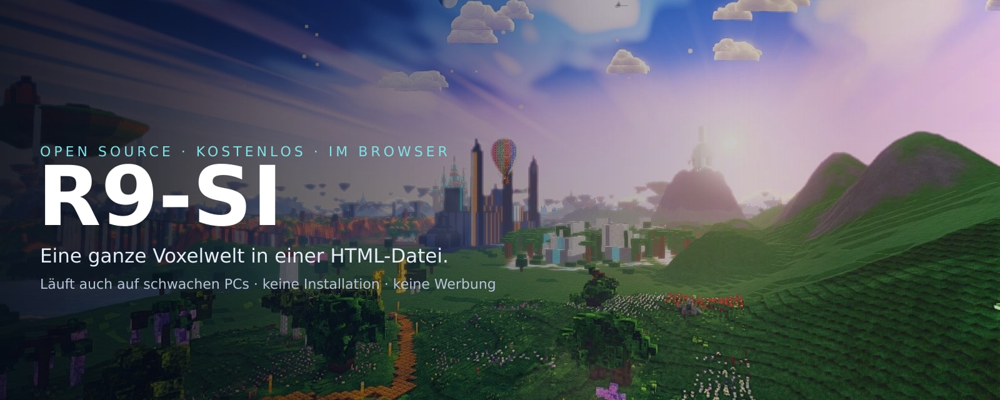</p>

<p align="center"><b>A whole voxel world in one HTML file.</b> Kostenlos · free · open source · no install.</p>

<p align="center">
<a href="https://n0t3-droid.github.io/R9-SI/"></a>
<a href="https://github.com/n0t3-droid/R9-SI/releases/latest/download/R9-SI.html"></a>
<a href="docs/R9-SI_Mathematik_und_Physik.pdf"></a>
<a href="lab/README.md"></a>
</p>

<p align="center">
<a href="https://github.com/n0t3-droid/R9-SI/tags"></a>
<a href="LICENSE"></a>


<a href="https://github.com/n0t3-droid/R9-SI/actions/workflows/pages.yml"></a>
</p>

<p align="center">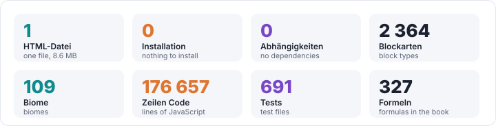</p>

Öffnen, und du bist in deiner Welt: kein Konto, kein Server, keine Installation. Alles darin ist eigener Code, von
Gelände und Städten bis Himmel, Wasser, Klang und Planetenbahnen.
*Open it and you are in your world: no account, no server, no install. Everything in it is our own code.*

## 🖼 Bilder · Gallery

<table>
<tr><td></td><td>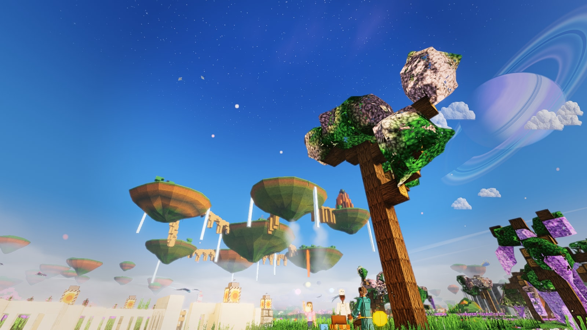</td></tr>
<tr><td></td><td></td></tr>
<tr><td colspan="2">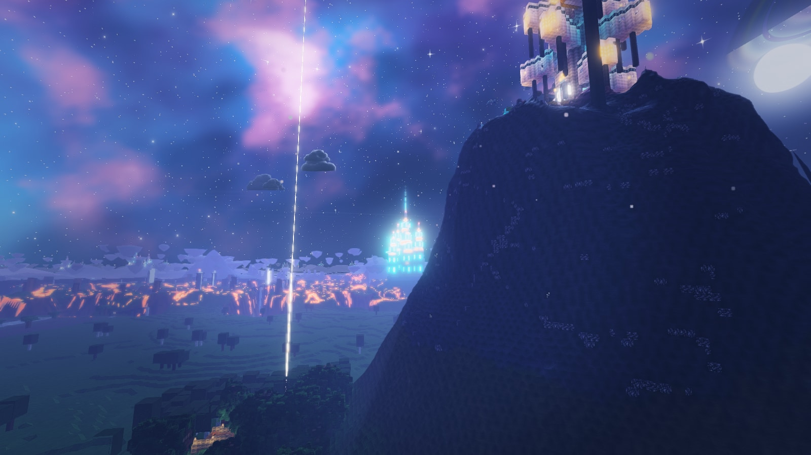</td></tr>
</table>
<sub>Jedes Bild ist das Spiel selbst auf Ultra, ohne Nachbearbeitung · every picture is the game itself
(<a href="test/marketing_shots.mjs">test/marketing_shots.mjs</a>).</sub>

## ⚙️ So funktioniert's · How it works

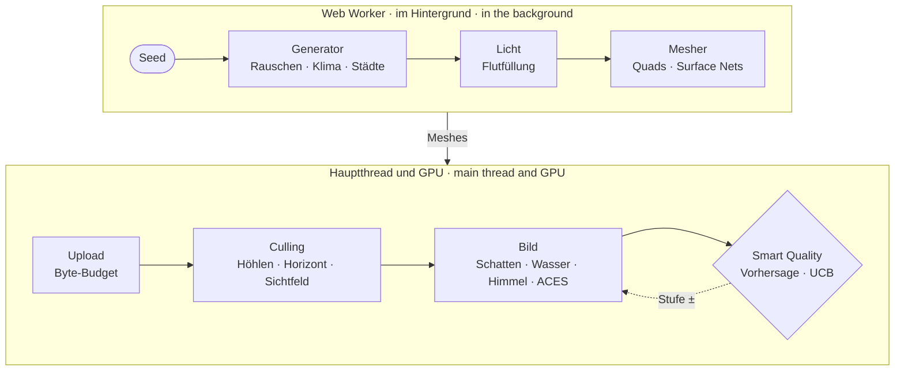

<sub>Generation is versioned (`vgen`): a world regenerates byte-identical for ever. Long tour: <a href="docs/TECHNIK.md">docs/TECHNIK.md</a>.</sub>

## 📐 Mathe, die man sieht · Math you can see

Jede Formel steht so im Code, mit Datei. Jedes Diagramm ist aus dem Code oder aus Messungen gezeichnet
([`docs/media/make_charts.js`](docs/media/make_charts.js), Rohdaten [`zahlen.json`](docs/media/data/zahlen.json)).

### 🌄 Gelände · Terrain

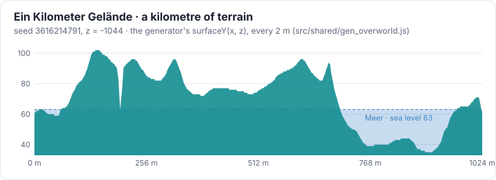

```math
h(x,z)=\frac{\sum_{i=0}^{n-1} p^{\,i}\, S_i\!\left(\lambda^{i} f x,\ \lambda^{i} f z\right)}{\sum_{i=0}^{n-1} p^{\,i}},\qquad p=\tfrac12,\ \ \lambda=2
```

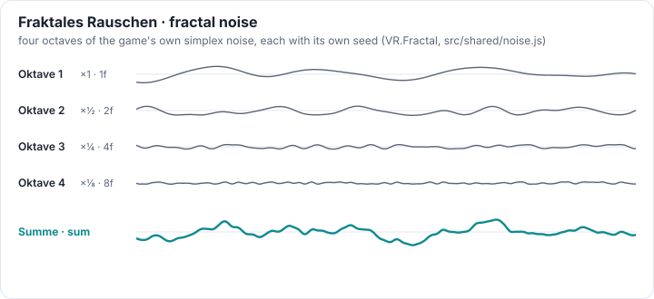

Jede Oktave hat ihren eigenen Keim, $`p`$ und $`\lambda`$ sind die Standardwerte · every octave has its own seed. → [`src/shared/noise.js`](src/shared/noise.js)

### 💡 Licht · Light

```math
L(\mathbf p)=\max\Bigl(E(\mathbf p),\ \max_{\mathbf q\sim\mathbf p} L(\mathbf q)-1-\varphi(\mathbf p)\Bigr),\qquad w=2^{12}s+2^{8}r+2^{4}g+b
```

Himmelslicht 15 fällt senkrecht, Blocklicht flutet in R, G, B zugleich; vier Bits je Kanal in einem 16-Bit-Wort.
*Sky light falls straight down, block light floods in three colours at once.* → [`src/shared/light_local.js`](src/shared/light_local.js)

### ⛰ Horizontschatten · Horizon culling

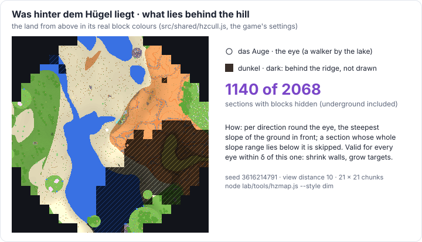

```math
T\ \text{verborgen}\iff\forall\beta\in B(T):\ \bigl[s^{\min}_\beta(T^{+\delta}),\ s^{\max}_\beta(T^{+\delta})\bigr]\subseteq I_\beta\!\left(O^{-\delta}\right)
```

```math
s=\frac{y-e_y}{\lVert (x,z)-(e_x,e_z)\rVert}\qquad\text{(Hangneigung vom Auge } e\text{ aus; slope seen from the eye)}
```

Pro Richtung $`\beta`$ die Hangneigungen, die näherer Boden verdeckt; Wände um $`\delta`$ geschrumpft, Ziele gewachsen:
das gilt dann für jedes Auge im Umkreis $`\delta`$. *Per direction the slopes nearer ground blocks; shrink the walls,
grow the targets, and the verdict holds for every eye within δ.* → [`src/shared/hzcull.js`](src/shared/hzcull.js) ·
Beweis · proof: [`test/hzcull.js`](test/hzcull.js)

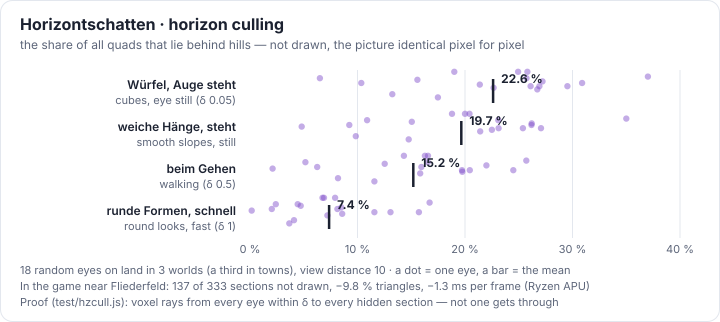

### 🌈 Himmel und Bild · Sky and picture

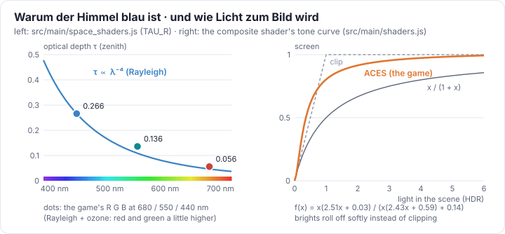

```math
\tau_R(\lambda)\propto\lambda^{-4},\qquad P_R(\theta)=\tfrac34\left(1+\cos^2\theta\right),\qquad P_M(\theta)=\frac{1-g^2}{\left(1+g^2-2g\cos\theta\right)^{3/2}},\ \ g=0.76
```

```math
f(x)=\frac{x\,(2.51x+0.03)}{x\,(2.43x+0.59)+0.14},\qquad D_{\mathrm{GGX}}(\mathbf h)=\frac{\alpha^2}{\pi\left((\mathbf n\cdot\mathbf h)^2(\alpha^2-1)+1\right)^2}
```

→ [`src/main/space_shaders.js`](src/main/space_shaders.js) · [`src/main/shaders.js`](src/main/shaders.js)

### 🎸 Klang · Sound

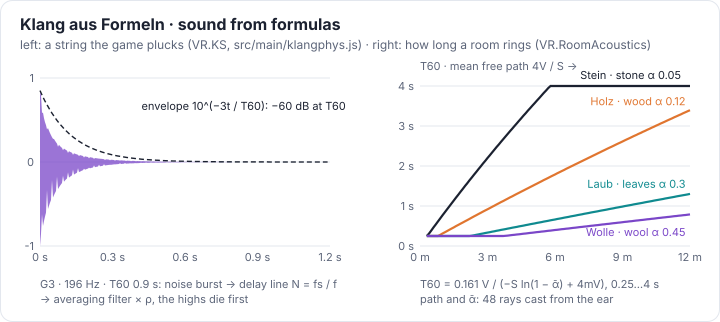

```math
y[n]=\rho\,\frac{y[n-N]+y[n-N-1]}{2},\qquad N=\frac{f_s}{f},\qquad \rho=\frac{10^{-3/(T_{60}f)}}{\cos(\pi f/f_s)}
```

```math
T_{60}=\frac{0.161\,V}{-S\ln(1-\bar\alpha)+4mV},\qquad \frac{V}{S}=\frac{\bar\ell}{4}
```

Saiten werden gezupft, nicht abgespielt; der Hall kommt aus 48 Strahlen vom Ohr in die Blöcke.
*Strings are plucked, not played back; the reverb comes from 48 rays cast from the ear.* → [`src/main/klangphys.js`](src/main/klangphys.js)

### 🪐 Bahnen · Orbits

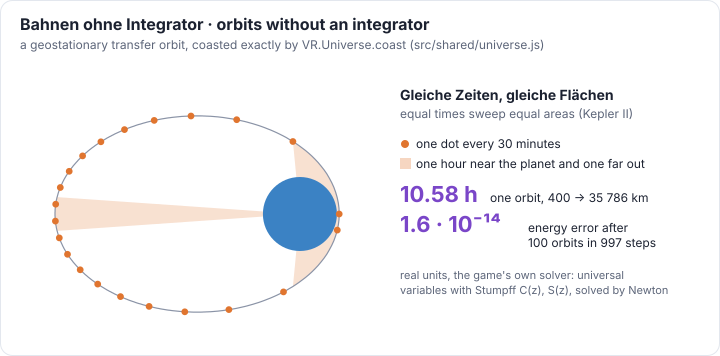

```math
\sqrt{\mu}\,\Delta t=\frac{\mathbf r_0\cdot\mathbf v_0}{\sqrt\mu}\,\chi^2C(z)+\left(1-\alpha r_0\right)\chi^3S(z)+r_0\,\chi,\qquad z=\alpha\chi^2,\quad \alpha=\frac{2}{r_0}-\frac{v_0^2}{\mu}
```

```math
C(z)=\frac{1-\cos\sqrt z}{z},\qquad S(z)=\frac{\sqrt z-\sin\sqrt z}{\sqrt{z^3}}
```

→ [`src/shared/universe.js`](src/shared/universe.js) · Sonne, Riesenplanet, Monde und Schiffe · sun, giant, moons and ships

### 🎛 Smart Quality

```math
\hat m(t+0.5\,\mathrm s)=a+b\,(t+0.5\,\mathrm s),\qquad z=\frac{\bar m_{\text{schnell}}-\bar m_{\text{langsam}}}{\sqrt{\sigma^2_{\text{langsam}}+1\,\mathrm{ms}^2}},\qquad \mathrm{UCB}_k=\bar r_k+c\sqrt{\frac{\ln N}{n_k}}
```

Das Spiel sieht teure Bilder kommen (Gerade durch 0,6 s), erkennt Überraschungen (z) und probiert die Stufe, die am
meisten verspricht (UCB1). *It sees slow frames coming, tells surprise from noise and tries the most promising rung.*
→ [`src/main/aqpredict.js`](src/main/aqpredict.js)

### 🧊 Eine Koordinate in 16 Bit · a coordinate in 16 bits

```math
\mathbf p=\frac{\mathbf a}{2048}-4,\qquad \mathbf a\in\{0,\dots,65535\}^3\quad\Rightarrow\quad \Delta p=\tfrac{1}{2048}\ \text{Block}
```

→ [`src/shared/mesher.js`](src/shared/mesher.js) · [`src/main/shaders.js`](src/main/shaders.js) · alle 327 Formeln · all
327 formulas: [**Mathe-Heft (PDF)**](docs/R9-SI_Mathematik_und_Physik.pdf)

## 📊 Gemessen · Measured

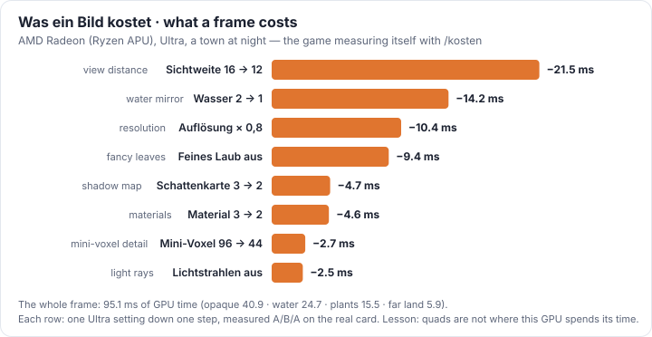

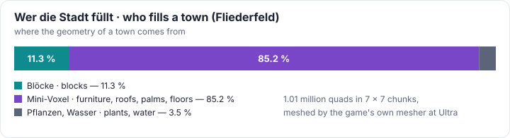

## ⬇ Alles kostenlos · Everything free

| | Was · what | Wo · where |
|---|---|---|
| ▶ | Spiel online · play online | [n0t3-droid.github.io/R9-SI](https://n0t3-droid.github.io/R9-SI/) |
| 🎮 | Spiel als eine Datei · the game as one file | [`R9-SI.html`](https://github.com/n0t3-droid/R9-SI/releases/latest/download/R9-SI.html) · [`play/`](play/) |
| 🛠 | Editor R9 Studio (.schem .nbt .litematic .vox .json) | [`R9-SI-Studio.html`](https://github.com/n0t3-droid/R9-SI/releases/latest/download/R9-SI-Studio.html) |
| 📦 | Alles in einem ZIP · everything zipped | [`R9-SI.zip`](https://github.com/n0t3-droid/R9-SI/releases/latest/download/R9-SI.zip) · [alle Versionen · all versions](https://github.com/n0t3-droid/R9-SI/releases) |
| 📘 | Mathe-Heft, 33 Seiten · math book | [PDF](docs/R9-SI_Mathematik_und_Physik.pdf) · [Quelle · source](docs/math/r9si_mathematik.html) |
| 🧪 | Labor: Welten vermessen, Fehler finden · the lab | [`lab/`](lab/README.md) |
| 📈 | Rohdaten der Diagramme · the charts' data | [`zahlen.json`](docs/media/data/zahlen.json) · [`make_charts.js`](docs/media/make_charts.js) |
| 🧾 | Der ganze Quelltext · all the source | [ZIP](https://github.com/n0t3-droid/R9-SI/archive/refs/heads/main.zip) · MIT |

## 🔧 Selbst bauen · Build it yourself

```bash
git clone https://github.com/n0t3-droid/R9-SI && cd R9-SI
node build.js                 # → dist/index.html (game) · dist/studio.html (editor)
node test/hzcull.js           # one of 691 tests: ✓ / ✗ per check
bash test/regress.sh          # the release set (browser tests need Playwright)
```

Bauen braucht nur Node, kein `npm install` · building needs Node only. Mitmachen · contributing: [CONTRIBUTING.md](CONTRIBUTING.md) ·
alle Versionen · every release: [docs/CHANGELOG.md](docs/CHANGELOG.md)

## ⚖️ Rechtliches · Legal

**An independent work.** R9-SI and R9 Studio are an independent, non-commercial hobby project — an original voxel game
inspired by the block sandbox genre. They are not affiliated with, endorsed, sponsored or approved by any other game
company. NOT AN OFFICIAL MINECRAFT PRODUCT. NOT APPROVED BY OR ASSOCIATED WITH MOJANG OR MICROSOFT. Minecraft is a
trademark of Mojang. Impressum, privacy policy and credits: 📜 in the pause menu, the settings and the Studio's header.

**Files.** The Studio opens structures from WorldEdit / Amulet / Axiom (.schem), vanilla structure files (.nbt),
Litematica (.litematic), MagicaVoxel (.vox) and R9 Bauteile (.json), and exports .schem, .vox and .json.
NOT AN OFFICIAL MINECRAFT PRODUCT. NOT APPROVED BY OR ASSOCIATED WITH MOJANG OR MICROSOFT. WorldEdit, Amulet,
Axiom, Litematica, MCEdit and MagicaVoxel are names or trademarks of their respective owners, named only to describe
which files the Studio reads and writes. Share only what is yours — every export says so in one line. Code: [MIT](LICENSE).
